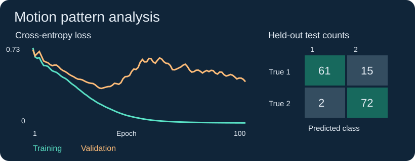

# Motion in frequency and time

**EC4102 · Signal processing and deep learning**

Can a model distinguish two similar gestures using only the horizontal position of a hand? This experiment turns a 150-sample trajectory into a sequence of short Fourier descriptors, then learns which intervals matter through self-attention.

## Evaluation

| Official test accuracy | Macro precision | Macro recall | Macro F1 |
| --- | --- | --- | --- |
| **88.67%** | 0.8979 | 0.8878 | 0.8861 |

The requested benchmark was **90–91%**. The table reports the saved checkpoint's predictions on the 150 recordings in the official test partition. Macro scores weight both classes equally.



[Exact counts and per-class scores](results/metrics.json) · [Epoch history](results/history.json) · [Trained parameters](results/checkpoint.json)

## From trajectory to decision


**Dataset.** GunPoint contains staged recordings from two actors performing a pointing gesture or a replica-draw gesture. The released signal tracks horizontal hand position. This project preserves the archive's numeric class labels 1 and 2. [Dataset description](https://www.timeseriesclassification.com/description.php?Dataset=GunPoint) · [Data mirror](https://github.com/aeon-toolkit/aeon/tree/main/aeon/datasets/data/GunPoint)

**Frequency-domain component.** Each window contributes its mean position, mean signed velocity, log-scaled mean absolute second difference, and magnitudes of discrete Fourier bins 1 and 2. These bins describe one and two cycles per window. Two sinusoidal position coordinates encode where the window falls in the gesture. This compact representation discards local spectral phase and higher bins. Its classification score measures gesture recognition, not reconstruction quality.

**Encoder.** A learned projection embeds seven features into 12 channels. One scaled dot-product attention head compares every window with all 15 windows. Residual connections and layer normalization surround attention and a 12 → 24 → 12 ReLU network. Temporal mean and maximum pooling feed the final classifier.

## Experimental protocol

| Setting | Value |
| --- | --- |
| Training source | Official 50-recording training partition |
| Validation | Every fifth recording within each numeric class, starting with the first |
| Optimizer | Full-batch Adam, learning rate 0.008 |
| Schedule | 100 epochs, lowest validation cross-entropy wins |
| Initialization | Seeded normal weights, standard deviation 0.22 |
| Runtime | Node.js 22+ and TensorFlow.js 4.22.0, CPU |

## Run the experiment

From the repository root, with Node.js installed:

```sh
node setup.mjs
node src/run.cjs evaluate
```

The first command downloads the benchmark and pinned TensorFlow.js runtime. The second evaluates the supplied checkpoint. To retrain, replace the checkpoint, and regenerate the figure:

```sh
node src/run.cjs train
node src/run.cjs evaluate
node src/plot.cjs
```

For inference, save a JSON array of 150 finite horizontal positions on the same scale as the archive and run `node src/run.cjs predict trace.json`. The output is an archive class ID.

## Interpretation and limits

Each error changes test accuracy by about 0.67 percentage points. Two actors and a small validation partition limit conclusions about unfamiliar people, camera angles, and everyday movements. A useful follow-up would compare Fourier-only, time-only, and combined inputs on an actor-disjoint validation set before collecting a new test cohort.

The [reference project](https://github.com/kairo786/attention-based-Transformer-models-for-motion-pattern-analysis) uses positional encoding and multi-head attention. This CPU experiment uses a single attention head and works directly on short trajectory windows.


